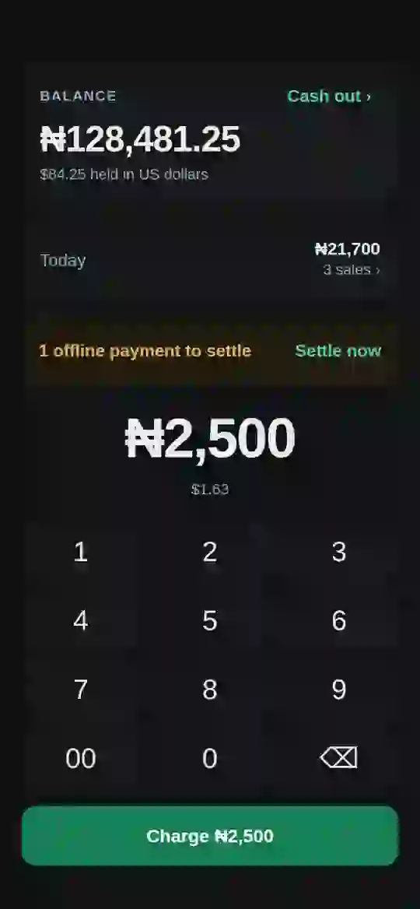
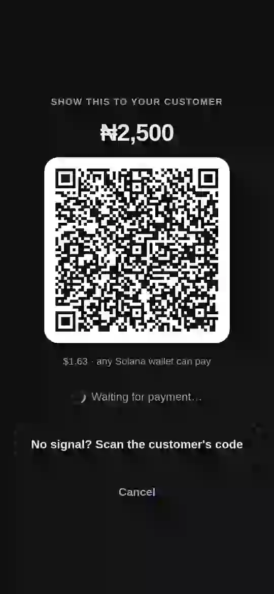
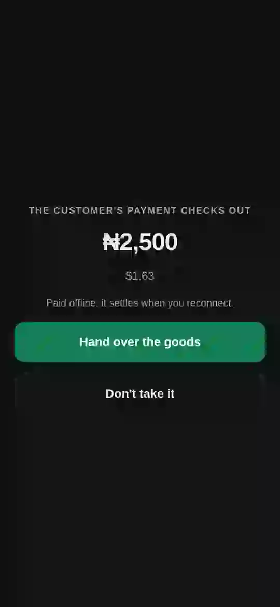
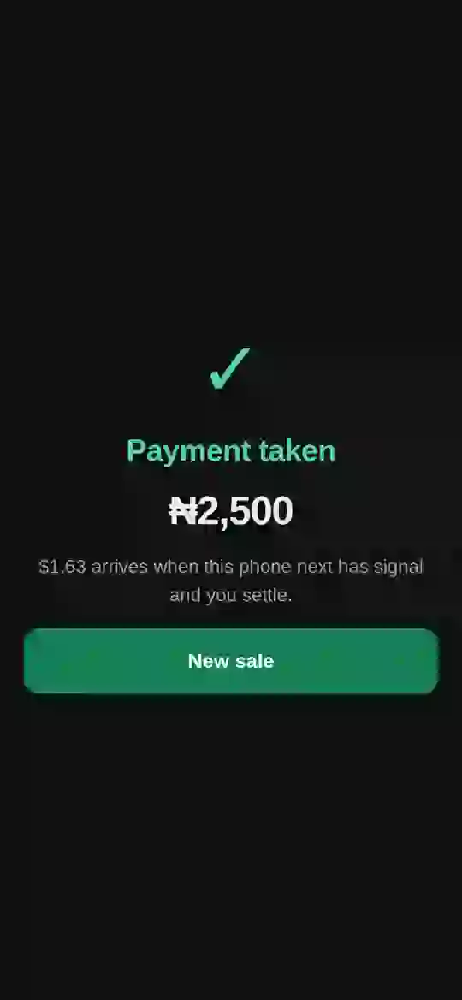
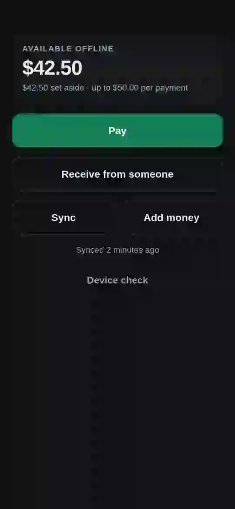
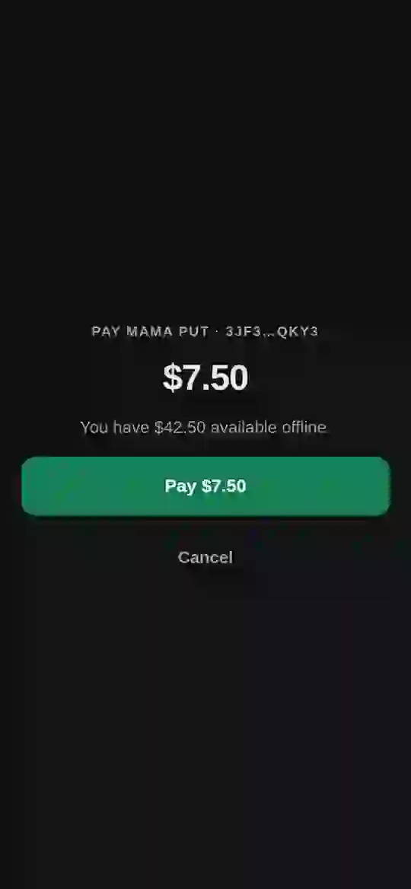
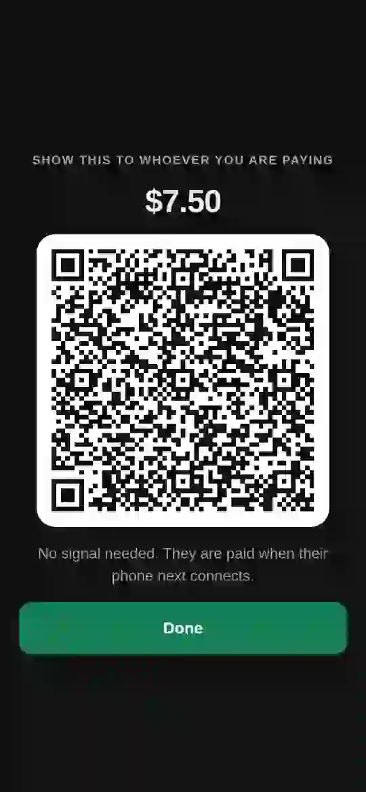
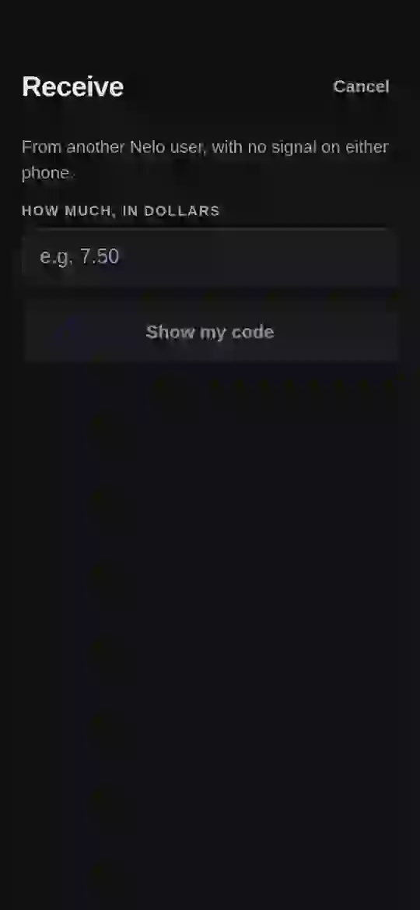
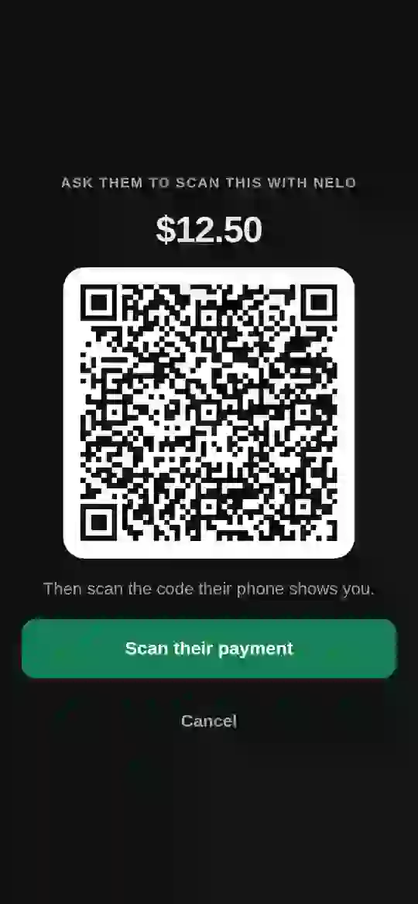

# Demo: the apps on real phones

**▶ Watch: [Send money to merchants, even without internet, live on Solana](https://www.youtube.com/watch?v=2vSyKGQ-EqE)** (3:30, two Android phones, release builds)

| Time | What it shows |
|---|---|
| 0:00 | **Online payment from a Solana wallet.** The till charges in naira and shows a Solana Pay code; Solflare scans and pays; the till confirms. |
| 0:15 | **Paying with nelo pay.** The merchant enters the amount, nelo pay scans and confirms, the till shows the payment taken and the payer's balance drops. |
| 0:58 | **Offline payment.** Network off on both phones. The till charges, nelo pay scans and signs, the till scans the payer's code and verifies it on the spot. The balance drops; the sale is recorded. |
| 1:28 | **Settling on reconnect.** Network back on; the merchant taps Settle and the relayer redeems the voucher on Solana. |
| 1:48 | **Over-limit and double-spend test.** About $7 left in the payer's vault; a ₦15,000 charge is refused. A payment under the vault limit then goes through. |
| 2:23 | **Cash-out to a Nigerian bank.** The merchant enters bank details, sees the holder's name, approves one mainnet USDC transfer in their wallet, and paj.cash pays naira into the bank; the bank's notification is shown on camera. |

Offline payments and redemptions run on **devnet** until the vault audit; the cash-out runs on
**mainnet**. A full transcript and captions are kept with the video.

## The screens

Recorded from the real apps.

### nelo for business — taking a sale

| Enter the amount | Show the code | Verify the payer's code | Payment taken |
|---|---|---|---|
|  |  |  |  |

### nelo pay — paying and receiving

| Home and offline balance | Confirm the payment | The signed voucher, as a QR | Ask a friend for money | The request code |
|---|---|---|---|---|
|  |  |  |  |  |

## The flows end to end

**Sign-in.** The merchant connects an existing wallet through Mobile Wallet Adapter, or signs up
with a Privy embedded wallet and never sees a key. The payer connects a wallet and enrols a
StrongBox key; a phone without a secure element is offered online payments only.

**Vault top-up.** The payer deposits USDC into their own vault (one wallet approval). The
offline balance shown is what the vault holds, rounded down, never up.

**A sale, online.** Any Solana Pay wallet pays the till's code. The till validates what actually
arrived — payee, mint, amount, success — not merely that a transaction exists.

**A sale, offline.** QR both ways; the till runs every check in [`SECURITY.md` §4](SECURITY.md)
with no network, records the sale in its day-book, and queues the voucher.

**Settlement.** When the till sees a network, its queue sends vouchers to the relayer, which
redeems them on Solana and pays the fee. The merchant needs no SOL and signs nothing.

**Cash-out.** Bank and account → holder's name → one approval in the merchant's wallet on
mainnet → "Sent" → "Paying your bank" → "Paid to your bank". Every step resumes after a dropped
connection without sending anything twice.

**Errors the apps explain in plain words.** Wrong account number ("That account could not be
found"), no signal ("Could not check the account. Try again with signal."), the relay unreachable
("Cannot reach the relay…"), the phone unable to find the server ("This phone could not find
Nelo's server… turn Wi-Fi off and on, or switch to mobile data"), a payment refused offline (the
reason from §4), below or above paj.cash's limits ($0.50–$10,000).

**Recovery.** A cash-out interrupted at any step continues where it stopped when retried. Vouchers
taken offline survive an app restart (SQLite). A phone without StrongBox degrades to online-only.
Not yet built: moving a vault to a new phone, and embedded-wallet recovery on a new device (both
on the [roadmap](ROADMAP.md)).
